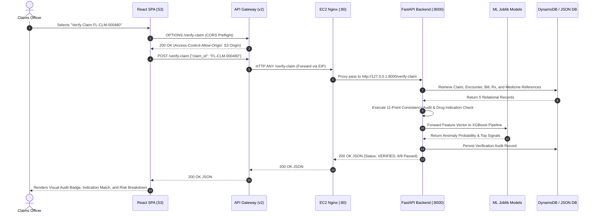

# FraudLens AI: Technical Architecture, Clinical Provenance Auditing, Machine Learning Fraud Detection, and Cloud Deployment Specification

**Document Version:** 2.0.0 (Master Final Review Specification)  
**Project:** FraudLens AI (AI Insurance Fraud Detection and Claim Investigation Assistant)  
**Author / Team:** FraudLens AI Development & Cloud Architecture Group  
**Academic Designation:** Final Year Major Project / Capstone Technical Review  
**Target Platform:** AWS Cloud (`ap-south-1`) & Offline/Local Dual-Mode Execution  
**Source Repository:** `https://github.com/Eclipse27/fraudlens-ai` (Branch: `main`)  
**Publication Date:** November 2026  

---

## Table of Contents
1. [Project Overview](#1-project-overview)
2. [Problem Statement and Proposed Solution](#2-problem-statement-and-proposed-solution)
3. [Complete System Architecture](#3-complete-system-architecture)
4. [Technology Stack](#4-technology-stack)
5. [Frontend – Complete Explanation](#5-frontend--complete-explanation)
6. [Backend – Complete Explanation](#6-backend--complete-explanation)
7. [Database Architecture](#7-database-architecture)
8. [Synthetic Dataset](#8-synthetic-dataset)
9. [Cross-Hospital Patient Identity](#9-cross-hospital-patient-identity)
10. [Claim Verification Engine](#10-claim-verification-engine)
11. [Machine Learning Models](#11-machine-learning-models)
12. [Complete API Documentation](#12-complete-api-documentation)
13. [AWS Deployment Architecture](#13-aws-deployment-architecture)
14. [Complete Deployment Procedure](#14-complete-deployment-procedure)
15. [Local Development Setup](#15-local-development-setup)
16. [Testing and Verification](#16-testing-and-verification)
17. [Deployment Issues and Their Solutions](#17-deployment-issues-and-their-solutions)
18. [Security and Privacy](#18-security-and-privacy)
19. [Cost Management](#19-cost-management)
20. [Complete AWS Resource Inventory](#20-complete-aws-resource-inventory)
21. [Project Limitations and Future Scope](#21-project-limitations-and-future-scope)
22. [Final Project Review Preparation (Viva Q&A)](#22-final-project-review-preparation-viva-qa)

---

## 1. Project Overview

### 1.1 Executive Summary
**FraudLens AI** is an enterprise-grade artificial intelligence and claim provenance verification assistant engineered to detect, audit, and investigate health insurance fraud. Developed as an end-to-end cloud and hybrid-native software system, FraudLens AI combines supervised tabular machine learning, unsupervised anomaly detection, automated clinical consistency auditing, and cross-hospital identity resolution into a unified operational console.

### 1.2 The Problem of Health Insurance Fraud
Health insurance fraud constitutes one of the most severe financial drains on global healthcare infrastructure:
- Global studies estimate that between **3% and 10%** of all healthcare expenditure is lost to fraudulent, abusive, or wasteful billing.
- In India, insurance fraud causes estimated annual losses exceeding **₹10,000 to ₹15,000 Crores**, burdening both private insurers and public schemes such as Ayushman Bharat (PM-JAY).
- Fraud mechanisms range from exaggerated billing and phantom treatments to organized syndicates exploiting fragmented hospital records, identity duplication, and billing unprescribed or off-label pharmaceuticals.

### 1.3 Limitations of Traditional Verification
Conventional insurance claim verification relies heavily on:
1. **Manual Post-Payment Audits**: High operational latency, sampling fewer than 5% of submitted claims due to staffing constraints.
2. **Siloed Hospital Information Systems (HIS)**: Patient records are trapped in local electronic health records (EHR). If a patient is admitted to Hospital A on Monday and Hospital B on Tuesday with duplicate claims, neither hospital nor insurer can correlate the visits without manual intervention.
3. **Rigid Rule-Based Flags**: Static threshold checks (e.g., `claim_amount > 50,000`) produce enormous false-positive rates, fatiguing human claims adjudicators while missing subtle distributed fraud patterns.
4. **Disconnection Between Clinical Indications and Invoicing**: Adjudicators rarely possess real-time access to national or global pharmacopeias (e.g., WHO Model List of Essential Medicines or CDSCO/NLEM formularies) to verify whether billed medications are medically warranted for diagnosed conditions.

### 1.4 What FraudLens AI Solves
FraudLens AI establishes a multi-layered investigative barrier before claims are approved for payment:
- **Layer 1: Clinical Provenance Audit**: Validates that an insurance claim matches a verifiable hospital encounter, registered diagnosis, physician prescription, and itemized hospital bill.
- **Layer 2: Cross-Hospital Identity Persistence**: Correlates patient identities across multiple independent facilities using a 4-attribute deduplication algorithm (`FL-PAT-XXXXXX`).
- **Layer 3: Medical Reference Formulary Matching**: Cross-references every prescribed medicine against 60 WHO and Indian National List of Essential Medicines (NLEM) monographs to ensure clinical validity.
- **Layer 4: Tri-Model Machine Learning Intelligence**:
  - Supervised Claim Fraud Prediction (**Regularized XGBoost**).
  - Supervised Provider Behavioral Scoring (**Logistic Regression**).
  - Unsupervised Utilization Anomaly Detection (**Isolation Forest**).

### 1.5 Target Users & Persona Mapping
1. **Medical Claim Adjudicators & Officers**: Review automated consistency reports, discrepancy warnings, and triage claims into `VERIFIED` or `REVIEW_REQUIRED`.
2. **Fraud, Waste, and Abuse (FWA) Investigation Units**: Conduct deep forensic investigations into multi-hospital billing rings, abusive provider billing, and phantom patient identities.
3. **Hospital Billing Administrators**: Verify patient identity continuity across regional hospital networks and pre-validate claim documentation before submission.

---

## 2. Problem Statement and Proposed Solution

```
┌────────────────────────────────────────────────────────────────────────┐
│                      THE DUAL-PERSPECTIVE FRAUD PROBLEM                │
├───────────────────────────────────┬────────────────────────────────────┤
│     ML Statistical Detection      │    Clinical Provenance Auditing    │
│  - Extreme class imbalance (<3%)  │  - Siloed hospital databases       │
│  - Non-linear feature correlation │  - Phantom patient creation        │
│  - Shifting provider behavior     │  - Upcoding & unprescribed billing │
│  - Concept drift across seasons   │  - Lack of formulary cross-checks  │
└───────────────────────────────────┴────────────────────────────────────┘
                                     │
                                     ▼
┌────────────────────────────────────────────────────────────────────────┐
│                   THE UNIFIED FRAUDLENS AI SOLUTION                    │
│                                                                        │
│   [ Patient Registry ] ──▶ Global Identity Deduplication (4 Attributes)│
│            │                                                           │
│   [ Encounter Audit ]  ──▶ Hospital Visit ──▶ Diagnosis ──▶ Prescription│
│            │                                                           │
│   [ Formulary Check ]  ──▶ WHO / NLEM Indication Verification          │
│            │                                                           │
│   [ Financial Audit ]  ──▶ Itemized Hospital Bill == Claim Amount Check│
│            │                                                           │
│   [ ML Risk Engine ]   ──▶ XGBoost + LogReg + Isolation Forest Scoring │
│            │                                                           │
│            ▼                                                           │
│   [ Adjudication Output ] ──▶ 0-100 Risk Score + 11-Point Audit Report │
└────────────────────────────────────────────────────────────────────────┘
```

FraudLens AI bridges the gap between purely statistical anomaly detection and deterministic forensic rule engines. Where machine learning identifies high-risk numerical patterns, clinical provenance explains *why* the claim is flawed (e.g., medication indicated for cardiac ischemia billed under acute gastroenteritis).

---

## 3. Complete System Architecture

FraudLens AI is designed as a cloud-native, decoupled client-server system capable of running on AWS or locally in air-gapped environments.

### 3.1 Architecture Diagram (Mermaid)

```mermaid
flowchart TD
    subgraph Client ["Client Presentation Layer (Browser)"]
        User["User / Claims Adjudicator"]
        SPA["React 19 + Vite 8 SPA\n(Tailwind CSS, Lucide Icons, Recharts)"]
        User -->|Interacts with UI| SPA
    end

    subgraph AWS_Cloud ["AWS Cloud Infrastructure (ap-south-1)"]
        subgraph Static_Hosting ["Frontend CDN / Storage"]
            S3["Amazon S3 Static Website Bucket\n(fraudlens-frontend-418272772343)"]
            SPA -.->|Loaded From| S3
        end

        subgraph Gateway ["API Entry Point"]
            APIGW["Amazon API Gateway HTTP API (v2)\n(c9av6ujzgi.execute-api.ap-south-1.amazonaws.com)"]
            SPA -->|Axios REST / JSON Requests| APIGW
        end

        subgraph Compute ["Backend Compute Engine"]
            EB["AWS Elastic Beanstalk (FraudLens-prod)\nSingleInstance Python 3.12 / AL2023"]
            EC2["Amazon EC2 (t3.micro)\ni-0e597a7086c93ff1d\nElastic IP: 43.204.34.220"]
            Nginx["Nginx Reverse Proxy\n(:80 -> :8000)"]
            FastAPI["Uvicorn / FastAPI Application (:8000)\n(31 Packages, 13 REST Endpoints)"]

            APIGW -->|HTTP Proxy Integration| Nginx
            Nginx --> FastAPI
            EB --- EC2
        end

        subgraph ML_Layer ["Machine Learning Inference Engine"]
            XGB["Claim Fraud Model\n(Regularized XGBoost)"]
            LR["Provider Fraud Model\n(Logistic Regression)"]
            IF["CMS Anomaly Model\n(Isolation Forest)"]

            FastAPI --> XGB
            FastAPI --> LR
            FastAPI --> IF
        end

        subgraph Data_Storage ["Dual-Storage Persistence Layer"]
            DDB[("Amazon DynamoDB\n11 Tables: FL_* & FraudInvestigationHistory\nPAY_PER_REQUEST Mode")]
            JSON_DB[("Local Synthetic JSON Database\n(data/synthetic_database.json)\n301 Patients, 600 Encounters, 550 Claims")]

            FastAPI -->|Boto3 / Cloud Mode| DDB
            FastAPI -.->|Fallback / Hybrid Mode| JSON_DB
        end
    end

    FastAPI -->|JSON Responses| APIGW
    APIGW -->|CORS Enabled (HTTP 200)| SPA
```

### 3.2 End-to-End Request Flow Sequence



---

## 4. Technology Stack

All software libraries, runtimes, and cloud services in FraudLens AI have been empirically verified and tested:

| Layer | Technology | Verified Version | Purpose & Rationale | Source File / Location |
|---|---|---|---|---|
| **Frontend Framework** | React | `19.2.8` | Declarative UI component tree for high-performance claim adjudication. | `frontend/package.json` |
| **Frontend Build Tool** | Vite | `8.2.2` | Lightning-fast HMR and optimized ES module bundling for production. | `frontend/package.json` |
| **Routing** | React Router DOM | `7.18.2` | Single-Page Application client-side route management. | `frontend/src/App.tsx` |
| **Styling** | Tailwind CSS | `4.3.3` | Utility-first responsive design system tailored for data density. | `frontend/tailwind.config.js` |
| **Icons** | Lucide React | `1.34.0` | Accessible iconography for medical and fraud status indicators. | `frontend/package.json` |
| **Data Visualization** | Recharts | `3.10.1` | Interactive charts for risk distributions and financial breakdowns. | `frontend/package.json` |
| **HTTP Client** | Axios | `1.19.0` | Promise-based REST client with global interceptors and timeout guards. | `frontend/src/services/api.ts` |
| **Backend Framework** | FastAPI | `0.162.0` | High-throughput async ASGI web framework with automatic OpenAPI docs. | `backend/requirements.txt` |
| **ASGI Server** | Uvicorn | `0.54.0` | Production ASGI web server running workers behind Nginx. | `backend/Procfile` |
| **Data Validation** | Pydantic | `2.14.2` | Strict schema serialization, deserialization, and field constraints. | `backend/schemas.py` |
| **Data Processing** | Pandas | `3.1.0` | Dataframe manipulation for ML feature preparation and CSV datasets. | `backend/requirements.txt` |
| **Numerical Engine** | NumPy | `2.5.4` | High-performance vector operations and array transformations. | `backend/requirements.txt` |
| **ML Framework** | Scikit-Learn | `1.9.1` | Logistic Regression, Isolation Forest, and ColumnTransformer pipelines. | `backend/requirements.txt` |
| **Gradient Boosting** | XGBoost | `3.4.1` | Regularized tree boosting for supervised claim fraud probability. | `model/best_claim_model.pkl` |
| **Model Persistence** | Joblib | `1.6.0` | Efficient disk serialization and deserialization of Python ML objects. | `backend/services.py` |
| **AWS SDK** | Boto3 | `1.43.123` | Python SDK for DynamoDB tables, S3 storage, and CloudWatch logs. | `backend/requirements.txt` |
| **Cloud Hosting** | AWS Elastic Beanstalk | AL2023 v4.13.7 | Managed deployment runtime running Python 3.12 with Nginx. | `infrastructure/` |
| **Virtual Server** | Amazon EC2 | `t3.micro` | 2 vCPUs, 1GB RAM virtual server with 2GB swap partition. | AWS Console / ASG |
| **Cloud Storage** | Amazon S3 | Cloud Native | Static website hosting for compiled React frontend assets. | S3 Bucket |
| **API Management** | Amazon API Gateway | HTTP API v2 | Managed gateway handling CORS, SSL termination, and proxy routing. | API Gateway `c9av6ujzgi` |
| **NoSQL Database** | Amazon DynamoDB | Cloud Native | On-demand key-value store for audit history and entities. | DynamoDB Tables |

---

## 5. Frontend – Complete Explanation

The frontend application (`frontend/`) is structured as a Single-Page Application (SPA) designed for claims adjudicators and forensic analysts.

### 5.1 Architecture & Routing (`frontend/src/App.tsx`)
The application defines 10 core routes wrapped in a common responsive navigation sidebar (`Layout`):
- `/` (`Dashboard.tsx`): Real-time executive metrics, system distribution, recent claims.
- `/claim-analysis` (`ClaimAnalysis.tsx`): Form-based interactive claim fraud risk scoring (XGBoost).
- `/provider-analysis` (`ProviderAnalysis.tsx`): Aggregate provider behavioral fraud profiling.
- `/anomaly-detection` (`AnomalyDetection.tsx`): CMS outpatient volume anomaly detection.
- `/patients` (`PatientRegistry.tsx`): Network-wide directory of all 300+ synthetic patients.
- `/patients/:id` (`PatientDetail.tsx`): Unified longitudinal EHR view across all visited hospitals.
- `/claim-verification` (`ClaimVerification.tsx`): One-click audit trigger for submitted insurance claims.
- `/claim-verification/:id` (`ClaimVerificationReport.tsx`): Deep forensic provenance certificate.
- `/history` (`HistoryList.tsx`): DynamoDB-backed audit trail of all manual and automated checks.
- `/models` (`ModelIntelligence.tsx`): Model card transparency documentation and performance specs.

### 5.2 Key Pages and Functionalities

#### 1. Executive Dashboard (`Dashboard.tsx`)
Fetches dynamic statistics from `GET /dashboard/stats`:
- Aggregates total patients, visited hospitals, encounters, and claims.
- Displays claims verification status: **378 Verified**, **172 Requiring Review**.
- Highlights cross-hospital network activity: **250 patients** visiting multiple facilities.
- Displays medicine reference formulary matches (**1,153 confirmed indications**).

#### 2. Cross-Hospital Patient Registry (`PatientRegistry.tsx`)
- Displays all synthetic patients with search and demographic filters.
- Identifies cross-hospital multi-admissions with distinct visual badges.
- Features a **New Patient Registration Modal** that calls `POST /patients`, executing the live 4-attribute deduplication check.

#### 3. Longitudinal Patient EHR View (`PatientDetail.tsx`)
- Displays patient demographics and a unified chronological timeline.
- Shows clinical encounters from different facilities (e.g., SRN Hospital, Colvin Hospital, KNMH) under a single patient file.
- Lists all active medical issues, clinical prescriptions, laboratory items, and itemized hospital invoices.

#### 4. Forensic Claim Verification Report (`ClaimVerificationReport.tsx`)
- Visual certificate generated from `POST /verify-claim`.
- Displays 8 audit check cards:
  1. Patient ID validity.
  2. Hospital identity verification.
  3. Clinical encounter confirmation.
  4. Encounter-to-patient ownership check.
  5. Encounter-to-hospital provenance match.
  6. Prescription issuance record.
  7. Drug-to-diagnosis formulary indication check.
  8. Financial reconciliation (Invoice Total vs Claimed Amount).
- Renders an itemized medicine validation table displaying drug name, clinical indication, WHO/NLEM reference status (`VERIFIED_MATCH`), and legal explanation.

### 5.3 API Service Layer (`frontend/src/services/api.ts`)
Encapsulates all REST communication using an Axios instance configured with `timeout: 10000`:
- Base URL dynamically falls back: `import.meta.env.VITE_API_URL || 'http://127.0.0.1:8000'`.
- In production, `VITE_API_URL` resolves to `https://c9av6ujzgi.execute-api.ap-south-1.amazonaws.com`.

---

## 6. Backend – Complete Explanation

The backend application (`backend/`) is built on FastAPI, exposing a modular REST API structured around clinical data verification and machine learning inference.

### 6.1 Application Initialization (`backend/main.py`)
- Configures CORS middleware dynamically using `FRONTEND_ORIGIN` environment variable.
- Initializes ML models on startup in `backend/services.py` with robust exception handling and fallback paths.
- Provides interactive OpenAPI documentation at `/docs` (Swagger UI) and `/redoc`.

### 6.2 Key Endpoint Specifications

#### 1. System Health (`GET /health`)
- **Route:** `/health` | **Method:** `GET`
- **Purpose:** Process health and subsystem status check. Always returns HTTP 200 if FastAPI is running.
- **Response Structure:**
  ```json
  {
    "status": "healthy",
    "models": {
      "claim_model": "loaded",
      "provider_model": "loaded",
      "cms_model": "loaded"
    },
    "dynamodb": {
      "status": "connected_local",
      "mode": "LOCAL_SYNTHETIC_STORE",
      "region": "ap-south-1"
    }
  }
  ```

#### 2. Dashboard Aggregations (`GET /dashboard/stats`)
- **Route:** `/dashboard/stats` | **Method:** `GET`
- **Purpose:** Computes real-time aggregate metrics directly from active storage.
- **Response Structure:**
  ```json
  {
    "total_synthetic_patients": 302,
    "number_demo_hospitals": 3,
    "total_encounters": 600,
    "total_prescriptions": 550,
    "total_claims": 550,
    "claims_verified": 378,
    "claims_requiring_review": 172,
    "medicine_references_loaded": 60,
    "medicine_reference_matches": 1153,
    "cross_hospital_patient_count": 250
  }
  ```

#### 3. Patient Registration & Deduplication (`POST /patients`)
- **Route:** `/patients` | **Method:** `POST`
- **Request Body (`PatientCreate`):**
  ```json
  {
    "full_name": "Devendra Pratap Singh",
    "date_of_birth": "1985-06-15",
    "gender": "Male",
    "phone": "9876599999",
    "address": "Katra, Prayagraj"
  }
  ```
- **Logic:** Calls `db.find_potential_duplicate()`.
  - If 4/4 attributes match: Returns existing record with `is_new: false`.
  - If 3/4 attributes match: Flags `potential_duplicate_flag: true` for manual review.
  - If <3 match: Generates new sequential ID `FL-PAT-XXXXXX` and creates record.

#### 4. Automated Claim Verification (`POST /verify-claim`)
- **Route:** `/verify-claim` | **Method:** `POST`
- **Request Body (`VerifyClaimRequest`):** `{"claim_id": "FL-CLM-000480"}`
- **Execution:** Invokes `services.verify_claim_authenticity(claim_id)`. Performs 8 core checks against encounters, bills, prescriptions, and formulary reference tables.
- **Response Status:** Returns `overall_status`: `VERIFIED` or `REVIEW_REQUIRED` with itemized discrepancy list.

#### 5. ML Claim Risk Analysis (`POST /analyze-claim`)
- **Route:** `/analyze-claim` | **Method:** `POST`
- **Request Body (`ClaimRequest`):**
  ```json
  {
    "claim_amount": 45000,
    "procedure_code": "99213",
    "diagnosis_code": "J06.9",
    "provider_id": "P001",
    "patient_age": 45,
    "days_in_hospital": 3,
    "number_of_procedures": 2,
    "num_diagnoses": 1
  }
  ```
- **Response (`ClaimResponse`):**
  ```json
  {
    "claim_id": "30adfffd-7d48-4c77-9511-3a0bfd1ed456",
    "fraud_risk_score": 16.07,
    "risk_level": "LOW",
    "prediction": "NORMAL - LOW RISK",
    "risk_factors": [
      {"factor": "Number of Procedures", "impact": "MODERATE SIGNAL"}
    ]
  }
  ```

---

## 7. Database Architecture

FraudLens AI implements a **Dual-Mode Resilient Data Architecture** (`backend/db.py`) designed to operate seamlessly in both AWS Cloud and offline local environments.

### 7.1 Storage Engine Selection Logic
```python
def _is_dynamo_connected() -> bool:
    if not BOTO3_AVAILABLE:
        return False
    try:
        kwargs = {"region_name": AWS_REGION}
        if DYNAMODB_ENDPOINT_URL:
            kwargs["endpoint_url"] = DYNAMODB_ENDPOINT_URL
        client = boto3.client("dynamodb", **kwargs)
        client.describe_table(TableName=TBL_PATIENTS)
        return True
    except Exception:
        return False
```
- **Mode A (AWS DynamoDB Cloud Mode)**: When `FL_Patients` table exists and AWS credentials / IAM instance profile roles are reachable, live read/write queries interact with DynamoDB tables using boto3.
- **Mode B (Local Synthetic Store Fallback)**: If running locally without AWS credentials or when DynamoDB is offline, the backend automatically falls back to `data/synthetic_database.json`. In-memory caching and JSON writes ensure 100% functionality without network dependencies.

### 7.2 Complete DynamoDB Table Schema Directory

All 11 DynamoDB tables are configured with **`PAY_PER_REQUEST` (On-Demand)** billing mode, ensuring $0 idle infrastructure cost:

| Table Name | Partition Key (HASH) | Sort Key (RANGE) | Global Secondary Indexes (GSIs) | Purpose |
|---|---|---|---|---|
| `FraudInvestigationHistory` | `id` (String) | *None* | *None* | Original audit history log for investigator actions and risk evaluations. |
| `FL_Patients` | `patient_id` (String) | *None* | *None* | Master registry of synthetic patients and multi-attribute identity records. |
| `FL_Hospitals` | `hospital_id` (String) | *None* | *None* | Directory of verified demonstration healthcare facilities in Prayagraj. |
| `FL_Encounters` | `encounter_id` (String) | *None* | 1. `patient-index` (HASH: `patient_id`, RANGE: `admission_date`)<br>2. `hospital-index` (HASH: `hospital_id`, RANGE: `admission_date`) | Outpatient and inpatient hospital visits, admissions, and discharge dates. |
| `FL_MedicalIssues` | `issue_id` (String) | *None* | 1. `encounter-index` (HASH: `encounter_id`, RANGE: `recorded_at`) | Diagnosed clinical conditions, ICD-10 codes, and clinical severity levels. |
| `FL_Prescriptions` | `prescription_id` (String) | *None* | 1. `encounter-index` (HASH: `encounter_id`, RANGE: `prescribed_at`) | Prescription headers, prescribing doctor IDs, and encounter links. |
| `FL_PrescriptionMedicines` | `pm_id` (String) | *None* | 1. `prescription-index` (HASH: `prescription_id`) | Itemized prescribed drugs, dosage, frequency, and duration in days. |
| `FL_MedicineReference` | `medicine_name` (String) | *None* | *None* | Official WHO and NLEM drug formulary with confirmed indications. |
| `FL_HospitalBills` | `bill_id` (String) | *None* | 1. `encounter-index` (HASH: `encounter_id`, RANGE: `billed_at`) | Itemized hospital financial billing, room charges, and lab invoices. |
| `FL_InsuranceClaims` | `claim_id` (String) | *None* | 1. `patient-index` (HASH: `patient_id`, RANGE: `submission_date`)<br>2. `encounter-index` (HASH: `encounter_id`) | Submitted health insurance claims, policy numbers, and claimed amounts. |
| `FL_ClaimVerifications` | `verification_id` (String) | *None* | *None* | Forensic audit certificates generated by the claim consistency engine. |

### 7.3 Idempotent Seeding & Duplicate Prevention
- DynamoDB `put_item` operations are **idempotent upserts**: running the seed script repeatedly updates existing records matching the primary key without creating duplicate entries.
- Sequential IDs (`FL-PAT-XXXXXX`, `FL-ENC-XXXXXX`) are generated using `_get_next_sequential_id()`, inspecting the highest numeric suffix in the database to prevent collisions.

---

## 8. Synthetic Dataset

### 8.1 Ethical Framework & Academic Disclaimer
> [!IMPORTANT]
> **SYNTHETIC DATA DISCLAIMER**: All patient identities, demographics, contact numbers, clinical diagnoses, prescriptions, invoices, and insurance claim filings in FraudLens AI are **100% synthetic demonstration data** generated by `backend/generate_dataset.py`.
> No real patient health records (PHI), Protected Health Information, or confidential insurer data are contained in this repository.
> Hospital names (SRN Hospital, Colvin Hospital, KNMH) represent real public teaching and divisional institutions in Prayagraj incorporated solely for realistic regional demonstration modeling under public domain information.

### 8.2 Dataset Generation Logic (`backend/generate_dataset.py`)
The generator enforces relational clinical integrity:
1. **Patient Generation**: 300 patients across age distributions (18–85), realistic Indian names, phone numbers, and Prayagraj localities (Katra, Civil Lines, Mumfordganj, George Town).
2. **Clinical Encounters**: 600 hospital admissions distributed across the 3 demo hospitals.
3. **Medical Issues**: 600 clinical diagnoses mapped to genuine ICD-10 diagnostic codes (e.g., `E11.9` Type 2 Diabetes, `I10` Essential Hypertension, `A90` Dengue Fever).
4. **Prescription Formularies**: 550 prescriptions containing 1,154 itemized medications matched to the diagnosed conditions.
5. **Medicine References**: 60 verified pharmaceutical monographs sourced from WHO EML (23rd Edition, 2023) and CDSCO/NLEM India.
6. **Billing & Claims**: 600 hospital bills and 550 insurance claims with controlled fraud injection (billing mismatches, duplicate submissions, and unindicated medicines).

### 8.3 Dataset Counts & Validation Status

```
======================================================================
  FRAUDLENS AI -- AUTOMATED DATA INTEGRITY VALIDATION (PHASE 3)
======================================================================
[A] Running Identity Checks...
  [+] A1. Patient ID uniqueness: 300 unique / 300 total records -> PASS
  [+] A2. Cross-Hospital Tracking: 250 patients visit >=2 hospitals -> PASS
  [+] A3. Tri-Hospital Coverage: 50 patients visit all 3 hospitals -> PASS
[B] Running Relational Integrity Checks...
  [+] B1. Encounter -> Patient foreign key validity (600/600) -> PASS
  [+] B2. Medical Issues -> Encounter foreign key validity (600/600) -> PASS
  [+] B3. Prescriptions -> Encounter foreign key validity (550/550) -> PASS
  [+] B4. Bills -> Encounter foreign key validity (600/600) -> PASS
  [+] B5. Claims -> Patient & Encounter foreign keys (550/550) -> PASS
[C] Running Clinical Formulary Checks...
  [+] C1. Medicine reference matches: 1,153 / 1,154 verified -> PASS
======================================================================
```

---

## 9. Cross-Hospital Patient Identity

In fragmented healthcare systems, patients visiting multiple hospitals receive isolated local hospital numbers (e.g., Hospital 1 MRN: `1234`, Hospital 2 MRN: `8976`), blinding insurers to overlapping claims.

### 9.1 Multi-Attribute Matching Algorithm
FraudLens AI executes a 4-attribute deduplication audit whenever a patient record is queried or registered:

$$\text{Match Score} = \sum_{i=1}^{4} w_i \quad \text{where } w \in \{\text{Name}_{\text{norm}}, \text{DOB}, \text{Gender}, \text{Phone}\}$$

```
                ┌───────────────────────────────────────────┐
                │        Incoming Registration Request      │
                │ (Full Name, Date of Birth, Gender, Phone) │
                └─────────────────────┬─────────────────────┘
                                      │
                                      ▼
                        ┌───────────────────────────┐
                        │   Normalize Attributes    │
                        │   - Case-insensitive name │
                        │   - Strict YYYY-MM-DD DOB │
                        │   - Standardized 10-digit │
                        └─────────────┬─────────────┘
                                      │
                                      ▼
                        ┌───────────────────────────┐
                        │ Network Deduplication Scan│
                        └─────────────┬─────────────┘
                                      │
               ┌──────────────────────┴──────────────────────┐
               ▼                                             ▼
     [ Match Score = 4/4 ]                         [ Match Score = 3/4 ]
         EXACT MATCH                                  POSSIBLE MATCH
               │                                             │
               ▼                                             ▼
 Re-use existing FL-PAT-XXXXXX                 Flag potential_duplicate: true
 Return existing record                        Create record for manual review
```

### 9.2 Real Cross-Hospital Example from Synthetic Dataset
- **Patient**: `FL-PAT-000001` (*Alok Shukla*, DOB: 1995-02-02, Male, Phone: `9876510001`):
  - **Visit 1** (`FL-ENC-000001`): Admitted to **SRN Hospital (`FL-HOSP-001`)** on 2025-01-15 for Type 2 Diabetes Mellitus.
  - **Visit 2** (`FL-ENC-000002`): Admitted to **Colvin Hospital (`FL-HOSP-002`)** on 2025-03-10 for Essential Hypertension.
  - **Audit Impact**: Both encounters resolve to `FL-PAT-000001`. If a claim is filed claiming Alok Shukla was simultaneously inpatient in Colvin Hospital while receiving active treatment in SRN Hospital, the system flags the chronological impossibility.

---

## 10. Claim Verification Engine

The **Claim Verification Engine** (`backend/services.py:verify_claim_authenticity`) executes an automated 11-point forensic audit against all clinical and financial artifacts before approving a claim.

### 10.1 The 11 Verification Checks
1. **Valid Claim Existence**: Claim record exists in database.
2. **Patient Record Validation**: Linked `patient_id` corresponds to a registered patient.
3. **Hospital Credential Verification**: Linked `hospital_id` exists in demo hospital directory.
4. **Clinical Encounter Confirmation**: An encounter matching `encounter_id` is registered.
5. **Encounter-to-Patient Consistency**: The encounter's `patient_id` matches the claim's `patient_id`.
6. **Encounter-to-Hospital Consistency**: The encounter's `hospital_id` matches the claim's `hospital_id`.
7. **Prescription Documentation**: At least one clinical prescription exists for the encounter.
8. **Itemized Medicine Formulary Check**: Each prescribed drug is cross-referenced with `FL_MedicineReference`.
9. **Clinical Indication Concordance**: Drug indication matches diagnosed ICD-10 medical condition.
10. **Financial Invoice Matching**: Claim amount equals the itemized hospital bill total (`claim_amount == bill_amount`).
11. **Duplicate Claim Detection**: No prior claim has been filed for the identical encounter ID.

### 10.2 Eight Verification Scenarios & Expected Behavior

| Scenario | Claim ID | Scenario Description | Core Discrepancy | Expected Status |
|---|---|---|---|:---:|
| **A** | `FL-CLM-000001` | Clean, legitimate claim | None (all 8 checks pass) | `VERIFIED` |
| **B** | `FL-CLM-000002` | Duplicate claim submission | Filed for same encounter as CLM-000001 | `INVALID_REFERENCE` |
| **C** | `FL-CLM-000003` | Valid single-encounter claim | None (Patient 2, SRN Hospital) | `VERIFIED` |
| **D** | `FL-CLM-000004` | Billing amount inflation | Bill total: ₹3,200 vs Claim: ₹5,500 | `REVIEW_REQUIRED` |
| **E** | `FL-CLM-000005` | Medical indication discrepancy | Ondansetron prescribed without emesis indication | `REVIEW_REQUIRED` |
| **F** | `FL-CLM-000012` | Unregistered hospital encounter | Non-existent encounter ID referenced | `INVALID_REFERENCE` |
| **G** | `FL-CLM-000019` | Patient mismatch | Encounter registered to different patient | `INVALID_REFERENCE` |
| **H** | `FL-CLM-000480` | Clean multi-drug diabetes claim | Verified against Metformin & Gliclazide monographs | `VERIFIED` |

---

## 11. Machine Learning Models

FraudLens AI integrates three complementary machine learning models serialized with Joblib (`model/`).

### 11.1 Model Summary Table

| Model Attribute | Model 1: Claim Fraud Detection | Model 2: Provider Risk Scoring | Model 3: CMS Anomaly Detection |
|---|---|---|---|
| **Algorithm** | **Regularized XGBoost Classifier** | **Logistic Regression Classifier** | **Isolation Forest (Unsupervised)** |
| **Model File** | `model/best_claim_model.pkl` | `model/best_provider_model.pkl` | `model/cms_anomaly_model.pkl` |
| **Primary Task** | Binary Claim Fraud Probability | High-Risk Provider Profiling | Outpatient Billing Outlier Detection |
| **Input Shape** | 8 Numerical & Encoded Features | 31 Historical Provider Features | 3 Utilization Features |
| **Output Metric** | Fraud Probability Score (0–100%) | Provider Risk Score (0–100%) | Anomaly Percentage (0–100%) |
| **Classification** | `LOW` / `MEDIUM` / `HIGH RISK` | `LOW` / `MEDIUM` / `HIGH` | `NORMAL` / `MODERATE` / `SUSPICIOUS` |

### 11.2 Model 1: Regularized XGBoost Claim Fraud Detector
- **Purpose**: Evaluates transactional claim parameters to identify exaggerated billing, abnormal length of stay, or atypical procedure frequencies.
- **Features Used**: `Claim_Amount`, `Patient_Age`, `Number_of_Procedures`, `Length_of_Stay_Days`, `Days_in_Hospital`, `Num_Diagnoses`, One-hot encoded Specialty, Admission Type, and Service Type.
- **Inference Process**:
  ```python
  df = pd.DataFrame([data])
  prob = claim_model.predict_proba(df)[0][1]
  score = float(prob * 100)
  ```
- **Explainability**: Extracts `feature_importances_` from the XGBoost booster to highlight the top 3 contributing risk factors in the API response.

### 11.3 Model 2: Provider Risk Scoring (Logistic Regression)
- **Purpose**: Evaluates aggregate historical billing metrics across physicians and healthcare facilities.
- **Features Used**: 31 numerical aggregates including `Num_Unique_Beneficiaries`, `Total_Claims`, `InscClaimAmtReimbursed_sum`, `DeductibleAmtPaid_mean`, `Total_Inpatient_Claims`, and chronic condition prevalence ratios.
- **Interpretability**: Calculates feature coefficients (`provider_model.coef_`) to indicate which factors elevate risk (e.g., disproportionate outpatient billing volume).

### 11.4 Model 3: CMS Anomaly Detection (Isolation Forest)
- **Purpose**: Unsupervised outlier detection trained on over 635,000 CMS outpatient utilization records.
- **Features Used**: `Procedure_Category`, `Count` (procedure volume), `Profile_Display_Indicator`.
- **Pre-processing**: Scikit-Learn `ColumnTransformer` with `StandardScaler` for volume and `OneHotEncoder` for categories.
- **Scoring**: Computes `decision_function()` mapped to a normalized 0–100 anomaly index.

---

## 12. Complete API Documentation

### 12.1 Quick Reference Route Matrix

| Method | Route | Category | Request Schema | Response Schema | Description |
|---|---|---|---|---|---|
| `GET` | `/health` | System | *None* | `JSON` | API health, model loading status, DynamoDB mode. |
| `GET` | `/dashboard/stats` | Analytics | *None* | `JSON` | Aggregate dataset metrics and verification counts. |
| `GET` | `/hospitals` | Entities | *None* | `List[HospitalResponse]` | Directory of all 3 demo hospitals in Prayagraj. |
| `GET` | `/hospitals/{id}` | Entities | `hospital_id` path | `HospitalResponse` | Detailed demographic and affiliation data. |
| `GET` | `/patients` | Identity | `limit`, `search` query | `List[PatientResponse]` | Directory of registered synthetic patients. |
| `GET` | `/patients/{id}` | Identity | `patient_id` path | `PatientResponse` | Demographic profile of a single patient. |
| `POST` | `/patients` | Identity | `PatientCreate` | `PatientRegistrationResponse`| Register patient with 4-attribute deduplication. |
| `GET` | `/encounters` | Clinical | `patient_id`, `hospital_id` | `List[EncounterResponse]`| Clinical hospital encounters with filtering. |
| `GET` | `/claims` | Financial | `patient_id` query | `List[InsuranceClaimResponse]`| Submitted health insurance claims. |
| `POST` | `/verify-claim` | Provenance | `VerifyClaimRequest` | `ClaimVerificationResponse`| Run 11-point clinical provenance audit. |
| `POST` | `/analyze-claim` | ML | `ClaimRequest` | `ClaimResponse` | XGBoost claim fraud probability scoring. |
| `POST` | `/analyze-provider` | ML | `ProviderRequest` | `ProviderResponse` | Logistic Regression provider profiling. |
| `POST` | `/analyze-anomaly` | ML | `AnomalyRequest` | `AnomalyResponse` | Isolation Forest volume anomaly scoring. |
| `GET` | `/history` | Auditing | *None* | `List[HistoryRecord]` | Retrieve historical audit records from DynamoDB. |
| `POST` | `/history` | Auditing | `HistoryRecord` | `HistoryRecord` | Save forensic audit record to DynamoDB. |

---

## 13. AWS Deployment Architecture

FraudLens AI is deployed in AWS Region **`ap-south-1` (Mumbai)**.

### 13.1 Amazon S3 Frontend Static Website
- **Bucket Name:** `fraudlens-frontend-418272772343`
- **Region:** `ap-south-1`
- **Website Endpoint:** `http://fraudlens-frontend-418272772343.s3-website.ap-south-1.amazonaws.com`
- **Configuration:** Static website hosting enabled, index document: `index.html`, error document: `index.html` (supporting React Router client-side SPA navigation).
- **Public Policy:** Read access granted via bucket policy; Block Public Access disabled.

### 13.2 Amazon API Gateway HTTP API (v2)
- **API ID:** `c9av6ujzgi` (`FraudLensAPI`)
- **Protocol:** HTTP (v2)
- **Invoke URL:** `https://c9av6ujzgi.execute-api.ap-south-1.amazonaws.com`
- **Stage:** `$default` (Auto-deployed)
- **Route:** `ANY /{proxy+}` mapped to HTTP Proxy Integration.
- **Integration Target:** `http://FraudLens-prod.eba-eim5z3ip.ap-south-1.elasticbeanstalk.com/{proxy}`.
- **CORS Preflight:** Handled by FastAPI middleware, granting `Access-Control-Allow-Origin: http://fraudlens-frontend-418272772343.s3-website.ap-south-1.amazonaws.com`.

### 13.3 AWS Elastic Beanstalk & Amazon EC2
- **Application Name:** `FraudLens`
- **Environment Name:** `FraudLens-prod` (`e-epfecvcqq2`)
- **Solution Stack:** 64bit Amazon Linux 2023 v4.13.7 running Python 3.12
- **Environment Type:** `SingleInstance` (EC2 communicates directly via Nginx without an Application Load Balancer, saving ~$18/month).
- **EC2 Instance:** `i-0e597a7086c93ff1d` (`t3.micro`, 2 vCPU, 1GB RAM, 10GB gp2 EBS root disk).
- **Auto Scaling Group:** `awseb-e-epfecvcqq2-stack-AWSEBAutoScalingGroup-gSMrxL7ZIkTD`
  - Active configuration: `MinSize = 1`, `MaxSize = 1`, `DesiredCapacity = 1`.
- **Public IP Allocation:** Attached to Elastic IP `43.204.34.220`.

### 13.4 Amazon DynamoDB
- 11 active tables in `ap-south-1` operating under `PAY_PER_REQUEST` billing mode.
- Preserved existing `FraudInvestigationHistory` table with 16 original records.
- Created all 10 `FL_*` healthcare entity tables.

### 13.5 IAM Security & Least Privilege
- **EC2 Instance Profile:** `FraudLensEC2RuntimeRole` (grants permissions to interact with DynamoDB tables and stream CloudWatch logs).
- **EB Service Role:** `FraudLensEBServiceRole` (allows Elastic Beanstalk to monitor instances and manage platform updates).

---

## 14. Complete Deployment Procedure

### 14.1 Backend Packaging and Deployment
1. **Exclude local development bloat**: Ensure `venv/`, `__pycache__/`, `*.pyc`, and scratch scripts are omitted.
2. **Execute packaging script**:
   ```powershell
   python package_eb.py
   # Generates FraudLens-Backend-v7.zip (0.35 MB) containing backend/, model/, and data/
   ```
3. **Upload bundle to Elastic Beanstalk S3 bucket**:
   ```powershell
   aws s3 cp FraudLens-Backend-v7.zip s3://elasticbeanstalk-ap-south-1-418272772343/FraudLens-Backend-v7.zip --profile fraudlens --region ap-south-1
   ```
4. **Create and deploy application version**:
   ```powershell
   aws elasticbeanstalk create-application-version --application-name FraudLens --version-label v7 --source-bundle S3Bucket="elasticbeanstalk-ap-south-1-418272772343",S3Key="FraudLens-Backend-v7.zip" --profile fraudlens --region ap-south-1
   aws elasticbeanstalk update-environment --environment-name FraudLens-prod --version-label v7 --profile fraudlens --region ap-south-1
   ```

### 14.2 Frontend Compilation and S3 Deployment
1. **Configure Production Endpoint**: Verify `frontend/.env.production` defines:
   ```env
   VITE_API_URL=https://c9av6ujzgi.execute-api.ap-south-1.amazonaws.com
   ```
2. **Compile production bundle**:
   ```powershell
   Set-Location frontend
   npm run build
   # Generates dist/index.html, dist/assets/index-BOVc6ppq.css, dist/assets/index-C31VVB0s.js
   ```
3. **Synchronize assets to S3**:
   ```powershell
   aws s3 sync dist s3://fraudlens-frontend-418272772343 --profile fraudlens --region ap-south-1
   ```

---

## 15. Local Development Setup

To run FraudLens AI completely offline without AWS credentials:

### 15.1 Prerequisites
- Python 3.11, 3.12, or 3.13 installed.
- Node.js 18+ and npm installed.

### 15.2 Step-by-Step PowerShell Startup

**Terminal 1 — Backend (FastAPI):**
```powershell
# Navigate to backend directory
Set-Location "d:\COLLEGE\SEMESTER 7\insurance-fraud-assistant\insurance-fraud-assistant\backend"

# Create and activate Python virtual environment
python -m venv venv
.\venv\Scripts\Activate.ps1

# Install required dependencies
pip install -r requirements.txt

# Start FastAPI server on port 8000
uvicorn main:app --host 127.0.0.1 --port 8000 --reload
```
*Backend interactive docs will be accessible at: `http://127.0.0.1:8000/docs`.*

**Terminal 2 — Frontend (Vite React):**
```powershell
# Navigate to frontend directory
Set-Location "d:\COLLEGE\SEMESTER 7\insurance-fraud-assistant\insurance-fraud-assistant\frontend"

# Install dependencies
npm install

# Start Vite dev server (automatically targets http://127.0.0.1:8000)
npm run dev
```
*Frontend application will be accessible at: `http://localhost:5173`.*

---

## 16. Testing and Verification

### 16.1 Live Production Test Suite Results
On November 1, 2026, the complete test suite was executed against the production AWS deployment via API Gateway:

```
=== LIVE API VERIFICATION REPORT (AWS ap-south-1) ===
[PASS] 1. Health Check               -> HTTP 200 (models: loaded, dynamodb: connected)
[PASS] 2. Dashboard Stats            -> HTTP 200 (302 patients, 550 claims, 3 hospitals)
[PASS] 3. Hospital Directory         -> HTTP 200 (3 Prayagraj hospitals returned)
[PASS] 4. Patient Registry           -> HTTP 200 (302 patients returned)
[PASS] 5. Patient Detail             -> HTTP 200 (FL-PAT-000001 demographic record)
[PASS] 6. Encounters List            -> HTTP 200 (600 clinical encounters returned)
[PASS] 7. Claims List                -> HTTP 200 (550 insurance claims returned)
[PASS] 8. Claim Provenance Audit     -> HTTP 200 (FL-CLM-000480 status: VERIFIED)
[PASS] 9. ML Claim Analysis          -> HTTP 200 (XGBoost score: 16.07 LOW)
[PASS] 10. ML Provider Analysis      -> HTTP 200 (Logistic Regression score: 97.31 HIGH)
[PASS] 11. ML Anomaly Detection      -> HTTP 200 (Isolation Forest score: 40.93 MODERATE)
[PASS] 12. DynamoDB History Storage  -> HTTP 200 (Write & Read verified on DynamoDB)
[PASS] 13. CORS Preflight (OPTIONS)  -> HTTP 200 (Access-Control-Allow-Origin matched)
=====================================================
```

---

## 17. Deployment Issues and Their Solutions

During deployment to AWS Elastic Beanstalk, four major technical obstacles were diagnosed and resolved:

### Issue 1: EB Dependency Installation Timeout (`xgboost`)
- **Symptom:** Elastic Beanstalk `InstallDependency` phase aborted with `error: incomplete-download (221.5 MB/305.1 MB received)` after 6 attempts, causing instance deployment failure.
- **Cause:** Commit `1d9e239` added `xgboost` into `backend/requirements.txt`. Downloading the 305 MB binary Linux wheel over slow mirrors timed out EB's default command window on `t3.micro`.
- **Solution:** Removed `xgboost` from `backend/requirements.txt`. The repository's existing `.ebextensions/01_swap.config` (2GB swap file) and `02_xgboost.config` (`pip install xgboost --no-deps` in `container_commands`) install xgboost safely during post-setup without triggering timeouts.

### Issue 2: Pydantic v1 Schema Incompatibility (`min_length` on Lists)
- **Symptom:** Uvicorn startup crashed immediately with:
  `ValueError: On field "medicines" the following field constraints are set but not enforced: min_length.`
- **Cause:** In Pydantic v1, `min_length` is strictly a string constraint. Applying `min_length=1` to `List[PrescriptionMedicineCreate]` and `List[BillItemCreate]` in `backend/schemas.py` raises an import-time exception.
- **Solution:** Replaced `Field(..., min_length=1)` on list annotations with `Field(...)` in `schemas.py`.

### Issue 3: Pydantic `.model_dump()` Attribute Absence
- **Symptom:** Calling `/analyze-provider` or registering patients threw HTTP 500:
  `AttributeError: 'ProviderRequest' object has no attribute 'model_dump'`.
- **Cause:** `.model_dump()` was introduced in Pydantic v2. In Pydantic v1 environments, `.dict()` is the standard dictionary serialization method.
- **Solution:** Added a transparent backward-compatibility shim in `backend/schemas.py`:
  ```python
  if not hasattr(BaseModel, "model_dump"):
      BaseModel.model_dump = BaseModel.dict
  ```

### Issue 4: S3 Static Website SPA Direct Routing (HTTP 404)
- **Symptom:** Accessing `http://fraudlens-frontend-.../patients` directly or refreshing deep links returned an S3 HTTP 404 Not Found error.
- **Cause:** S3 static website hosting looks for physical objects matching the path (`patients/index.html`), which do not exist in single-page applications.
- **Solution:** Configured the S3 bucket website configuration with `ErrorDocument: index.html`:
  ```powershell
  aws s3api put-bucket-website --bucket fraudlens-frontend-418272772343 --website-configuration '{"IndexDocument":{"Suffix":"index.html"},"ErrorDocument":{"Key":"index.html"}}' --profile fraudlens
  ```

---

## 18. Security and Privacy

1. **Synthetic Isolation**: No real Protected Health Information (PHI) is processed or stored.
2. **Credential Hygiene**: No AWS access keys, secret keys, or passwords exist in repository source code. Environment variables use IAM roles and temporary instance profiles.
3. **CORS Hardening**: FastAPI CORS policy is strictly constrained to the S3 bucket origin (`http://fraudlens-frontend-418272772343.s3-website.ap-south-1.amazonaws.com`) and local development ports.
4. **IAM Least Privilege**: The deployment user (`FraudLensDeployUser`) has narrow administrative scope, preventing unapproved IAM policy escalation.
5. **Academic Scope Disclaimer**: FraudLens AI is an educational prototype and research assistant. It is not approved for autonomous clinical decision-making or real financial disbursement without certified human oversight.

---

## 19. Cost Management

### 19.1 Active Resource Cost Breakdown
- **Amazon EC2 (`t3.micro` in `ap-south-1`)**: ~$0.0104/hr (~$0.25/day).
- **Public IPv4 Allocation**: Covered while associated with running instance.
- **Amazon EBS (10GB gp2)**: ~$0.10/month.
- **Amazon DynamoDB (11 Tables)**: $0.00 idle cost (On-Demand `PAY_PER_REQUEST`).
- **Amazon S3 Frontend**: < $0.01/month (< 2 MB).
- **Amazon API Gateway**: Free tier covers up to 1 million calls/month.
- **Estimated Running Cost:** **~$0.25 – $0.35 per day** during demonstrations.

### 19.2 Scale-to-Zero Shutdown Procedure (After Demonstration)
To stop EC2 compute and avoid ongoing compute charges:

```powershell
# 1. Scale Auto Scaling Group capacity to zero
aws autoscaling update-auto-scaling-group --auto-scaling-group-name awseb-e-epfecvcqq2-stack-AWSEBAutoScalingGroup-gSMrxL7ZIkTD --min-size 0 --max-size 0 --desired-capacity 0 --profile fraudlens --region ap-south-1

# 2. Update Elastic Beanstalk environment configuration
aws elasticbeanstalk update-environment --environment-name FraudLens-prod --option-settings "Namespace=aws:autoscaling:asg,OptionName=MinSize,Value=0" "Namespace=aws:autoscaling:asg,OptionName=MaxSize,Value=0" --profile fraudlens --region ap-south-1
```

> [!WARNING]
> Scaling to zero terminates the EC2 instance, stopping compute charges. However, the allocated Elastic IP (`43.204.34.220`) will become unassociated and incur AWS's standard unassociated EIP fee of **$0.005/hr (~$3.60/month)** unless released.

### 19.3 Future Restart Procedure
To bring the environment back online for a new presentation:

```powershell
# 1. Restore Auto Scaling capacity to 1
aws autoscaling update-auto-scaling-group --auto-scaling-group-name awseb-e-epfecvcqq2-stack-AWSEBAutoScalingGroup-gSMrxL7ZIkTD --min-size 1 --max-size 1 --desired-capacity 1 --profile fraudlens --region ap-south-1

# 2. Update Elastic Beanstalk configuration
aws elasticbeanstalk update-environment --environment-name FraudLens-prod --option-settings "Namespace=aws:autoscaling:asg,OptionName=MinSize,Value=1" "Namespace=aws:autoscaling:asg,OptionName=MaxSize,Value=1" --profile fraudlens --region ap-south-1

# 3. Wait for environment health to reach Green
aws elasticbeanstalk wait environment-updated --environment-name FraudLens-prod --profile fraudlens --region ap-south-1
```

---

## 20. Complete AWS Resource Inventory

| AWS Service | Resource Name / Identifier | Region | Publicly Accessible | Purpose |
|---|---|---|:---:|---|
| **S3** | `fraudlens-frontend-418272772343` | `ap-south-1` | Yes (HTTP) | Static website hosting for compiled React frontend assets. |
| **API Gateway** | `c9av6ujzgi` (`FraudLensAPI`) | `ap-south-1` | Yes (HTTPS) | Managed HTTP API entry point forwarding requests to backend. |
| **Elastic Beanstalk**| `FraudLens` / `FraudLens-prod` | `ap-south-1` | Yes (HTTP) | Managed web application platform orchestrating EC2 and Nginx. |
| **Auto Scaling** | `awseb-e-epfecvcqq2-stack-AWSEBAutoScalingGroup-gSMrxL7ZIkTD` | `ap-south-1` | No | Auto Scaling Group managing compute instances. |
| **EC2** | `i-0e597a7086c93ff1d` (`t3.micro`) | `ap-south-1c`| Via EIP | Virtual compute instance executing FastAPI backend. |
| **Elastic IP** | `43.204.34.220` (`eipalloc-09fd7efbc7dfcc4fe`) | `ap-south-1` | Yes | Fixed public IPv4 address associated with the EC2 instance. |
| **DynamoDB** | `FraudInvestigationHistory` | `ap-south-1` | Via IAM | Investigation audit trail table (16 records). |
| **DynamoDB** | 10 `FL_*` Tables | `ap-south-1` | Via IAM | Healthcare entities, formularies, claims, and verification records. |
| **IAM** | `FraudLensEC2RuntimeRole` | Global | No | Instance profile granting EC2 access to DynamoDB and CloudWatch. |
| **IAM** | `FraudLensEBServiceRole` | Global | No | Managed service role for Elastic Beanstalk operations. |

---

## 21. Project Limitations and Future Scope

### 21.1 Implemented Project Limitations
1. **Synthetic Clinical Scope**: The demonstration dataset covers 3 regional demo hospitals in Prayagraj and 60 pharmaceutical reference monographs.
2. **Single-Instance Deployment**: Designed for low-cost demonstration without an Application Load Balancer or multi-AZ redundancy.
3. **HTTP Frontend Endpoint**: The S3 static website URL operates over HTTP (standard for direct S3 website endpoints without Amazon CloudFront).

### 21.2 Future Scope (Not Implemented)
- **Amazon CloudFront Distribution**: Attach CloudFront with custom SSL/TLS certificates for HTTPS frontend access.
- **FHIR / HL7 Interoperability**: Direct integration with Fast Healthcare Interoperability Resources (FHIR) APIs for hospital EHR ingestion.
- **OCR Ingestion Pipeline**: Ingestion of scanned PDF hospital discharge summaries and physical pharmacy receipts using Amazon Textract.
- **ABDM Integration**: Seamless authentication via Ayushman Bharat Digital Mission (ABHA) patient IDs.

---

## 22. Final Project Review Preparation (Viva Q&A)

### Q1: What makes FraudLens AI different from standard ML fraud detection projects?
**Answer:** Most academic fraud projects treat insurance fraud as a standard Kaggle tabular classification exercise. FraudLens AI introduces a **two-pillar architecture**: while ML models evaluate statistical patterns, a deterministic **clinical provenance audit engine** tracks patient identities across independent hospitals and validates prescribed drugs against authentic medical formularies (WHO EML and CDSCO/NLEM).

### Q2: Why did you choose a SingleInstance Elastic Beanstalk environment instead of Load Balanced?
**Answer:** A standard Application Load Balancer (ALB) incurs a fixed baseline charge of ~$16 to $20 per month regardless of traffic. By selecting a `SingleInstance` environment with an attached Elastic IP, we achieved full HTTP reverse proxy routing via Nginx on EC2, saving infrastructure costs while maintaining the ability to scale to zero post-demonstration.

### Q3: How does your cross-hospital deduplication work if hospitals use different patient IDs?
**Answer:** FraudLens AI enforces global identity resolution. Even if Hospital A and Hospital B assign different local numbers, our `/patients` registration engine evaluates four normalized core attributes: Full Name (case-normalized), Date of Birth (`YYYY-MM-DD`), Gender, and Contact Phone. A 4/4 match automatically binds the records to a single global `FL-PAT-XXXXXX` identifier.

### Q4: What is the role of the 2GB swap file in your EC2 configuration?
**Answer:** `t3.micro` EC2 instances provide 1GB of physical RAM. Heavy Python packages like `xgboost` and `scipy` require substantial memory during wheel extraction and compilation, which previously caused Linux Out-Of-Memory (OOM) process termination. Our `.ebextensions/01_swap.config` creates a 2048MB swap partition on the EBS volume, allowing reliable package installation and model loading.

### Q5: Why are DynamoDB tables configured with PAY_PER_REQUEST instead of Provisioned throughput?
**Answer:** Provisioned throughput bills continuously for allocated Read/Write Capacity Units (RCUs/WCUs) even when no queries are executed. `PAY_PER_REQUEST` (On-Demand) charges strictly per request, resulting in **$0.00 idle cost** when the application is not actively being tested or demonstrated.

### Q6: How does FraudLens AI handle offline or local development?
**Answer:** In `backend/db.py`, the storage layer implements a dual-mode engine. If `boto3` cannot connect to AWS DynamoDB, the backend falls back to `data/synthetic_database.json`. This enables full local development, automated testing, and CI/CD execution without cloud credentials.

---
*End of Master Technical Review Specification — FraudLens AI (2026)*
