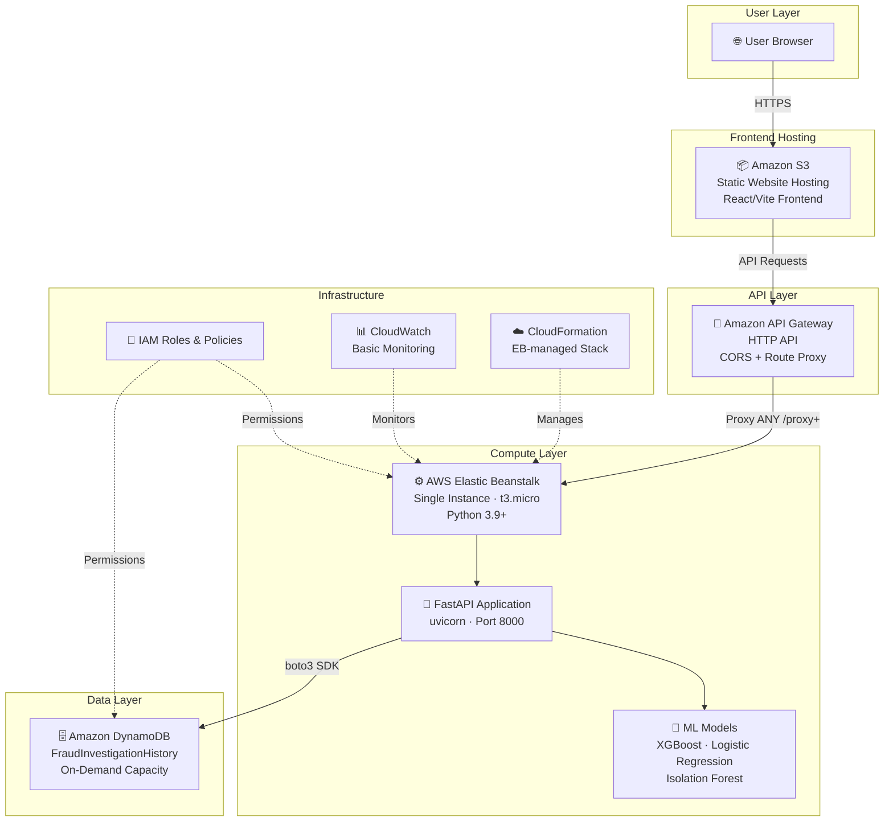

# FraudLens AI — Interim Review PPT Content

> **Instructions:** Each section below corresponds to one slide. Copy the content into your PPT slides.

---

## SLIDE 1 — PROJECT TITLE & TEAM DETAILS

### FraudLens AI
#### AI-Powered Insurance Fraud Detection & Claim Investigation Assistant

**A Cloud-Native Intelligent System for Healthcare Insurance Fraud Detection**

---

**Team Members:**

| Name | Register Number |
|------|----------------|
| [TEAM MEMBER 1 NAME] | [REGISTER NUMBER] |
| [TEAM MEMBER 2 NAME] | [REGISTER NUMBER] |
| [TEAM MEMBER 3 NAME] | [REGISTER NUMBER] |
| [TEAM MEMBER 4 NAME] | [REGISTER NUMBER] |

**Guide:** [GUIDE NAME]
**Department:** [DEPARTMENT NAME]
**Institution:** [INSTITUTION NAME]
**Semester:** 7 | **Academic Year:** 2026–2027

---

## SLIDE 2 — INDUSTRY PROBLEM & SDG ALIGNMENT

### The Insurance Fraud Problem

- **Global insurance fraud costs exceed $80 billion annually** in the US alone (Coalition Against Insurance Fraud).
- Healthcare insurance fraud specifically accounts for a significant share, involving fraudulent claims, phantom billing, upcoding, and provider collusion.
- **Manual investigation is slow, expensive, and reactive** — most fraud is detected only after payout.
- Fraudulent claims **increase premiums for honest policyholders** and divert resources from legitimate healthcare.
- The volume of claims (millions per year) makes it **impossible for human investigators to review every claim** manually.

### Why AI/Automation Is Needed

- ML models can **analyze patterns across thousands of features** in real time.
- AI can **flag high-risk claims before payout**, shifting detection from reactive to proactive.
- Reduces investigator workload by **prioritizing the highest-risk cases** for manual review.
- Continuous learning from new data enables detection of **evolving fraud schemes**.

### UN Sustainable Development Goal Alignment

| SDG | Relevance |
|-----|-----------|
| **SDG 16 — Peace, Justice & Strong Institutions** | Fraud detection promotes transparency, accountability, and institutional integrity in the insurance industry. Automated detection reduces corruption and financial crime. |
| **SDG 3 — Good Health & Well-Being** | By detecting fraudulent healthcare claims, the system helps preserve insurance fund integrity, ensuring resources are directed toward legitimate patient care. |

---

## SLIDE 3 — PROJECT OBJECTIVE & EXPECTED OUTCOME

### Problem Being Addressed

Insurance companies face significant financial losses due to fraudulent claims. Current manual review processes are slow, inconsistent, and cannot scale to the volume of modern claims. There is no widely accessible, integrated tool that combines multiple ML models with cloud infrastructure for comprehensive fraud investigation.

### Main Objective

To design and deploy a **cloud-native AI-powered investigation assistant** that enables insurance fraud investigators to analyze claims, evaluate providers, and detect anomalous utilization patterns — all through a unified web interface backed by machine learning and AWS cloud services.

### Specific Objectives

1. **Build three specialized ML models** — claim-level fraud detection (XGBoost), provider-level risk profiling (Logistic Regression), and utilization anomaly detection (Isolation Forest).
2. **Develop a modern React frontend** — with an investigator-friendly dashboard, interactive forms, risk visualization, and investigation history.
3. **Create a FastAPI backend** — with RESTful API endpoints for ML inference, data validation, and database operations.
4. **Deploy on AWS cloud infrastructure** — using S3, API Gateway, Elastic Beanstalk, and DynamoDB for a fully cloud-hosted production system.
5. **Persist investigation history** — using DynamoDB for auditability, case tracking, and historical review.

### Expected Outcomes

- A **working, deployed web application** accessible via a public URL.
- **Three trained ML models** producing real-time risk scores and recommendations.
- **Cloud-native architecture** demonstrating real-world deployment skills.
- **Investigation history** stored persistently in DynamoDB.
- **Scalable foundation** for future enhancements (alerts, dashboards, role-based access).

---

## SLIDE 4 — PROPOSED SOLUTION & MAJOR MODULES / FEATURES

### Major Modules

| # | Module | Purpose | Status |
|---|--------|---------|--------|
| 1 | **Claim Analysis Module** | Individual claim fraud risk assessment using Regularized XGBoost. User enters 18 claim features; system returns fraud risk score (0–100), risk level, AI-identified risk factors, and actionable recommendations. | ✅ **IMPLEMENTED** |
| 2 | **Provider Analysis Module** | Aggregate provider risk profiling using Logistic Regression over 31 features (financials, patient volume, chronic conditions). Returns provider fraud risk score, risk level, and top contributing factors. | ✅ **IMPLEMENTED** |
| 3 | **CMS Anomaly Detection Module** | Unsupervised anomaly detection on healthcare utilization patterns using Isolation Forest trained on 635,353 real CMS records. Flags unusual billing patterns (procedure category, count, display indicator). | ✅ **IMPLEMENTED** |
| 4 | **Investigation History Module** | Full CRUD operations on investigation records via DynamoDB. Users can view past analyses, filter by type/risk, view detailed reports, and clear history. Persists across sessions. | ✅ **IMPLEMENTED** |
| 5 | **Dashboard & Visualization Module** | Central command dashboard with summary metrics (total analyses, high-risk cases, suspicious patterns, active models), risk distribution pie chart (Recharts), recent activity feed, quick action navigation, and AI investigation insights. | ✅ **IMPLEMENTED** |
| 6 | **Model Intelligence Module** | Displays ML model status (loaded/not loaded), algorithm type, validation metrics (F1, PR-AUC, Recall, Generalization Gap), and configuration details for each of the three models. | ✅ **IMPLEMENTED** |
| 7 | **System Status Module** | Real-time health check showing FastAPI backend connectivity, DynamoDB status, model load status, and API base URL. Includes manual refresh capability. | ✅ **IMPLEMENTED** |
| 8 | **User Authentication & Role-Based Access** | Login system with investigator/admin roles and access control. | 📋 **PLANNED — Not Yet Implemented** |
| 9 | **Email/SNS Alert Notifications** | Automated alerts for high-risk detections via Amazon SNS. | 📋 **PLANNED — Not Yet Implemented** |

---

## SLIDE 5 — PROPOSED CLOUD ARCHITECTURE

### FraudLens AI — AWS Cloud Architecture



### How the Request Flows

1. **User** opens the FraudLens web application in their browser.
2. **Amazon S3** serves the static React/Vite frontend (HTML, JS, CSS) to the browser.
3. **Frontend** sends API requests (e.g., POST `/analyze-claim`) to the **API Gateway URL** configured via `VITE_API_URL`.
4. **Amazon API Gateway** receives the HTTPS request and proxies it to the **Elastic Beanstalk** environment.
5. **Elastic Beanstalk** hosts a `t3.micro` EC2 instance running **FastAPI** via uvicorn on port 8000.
6. **FastAPI** validates the request body (Pydantic), loads the relevant **ML model** (already in memory), performs inference, and generates the risk assessment.
7. The frontend then sends a second request to **save the result** to **DynamoDB** via the `/history` endpoint.
8. **DynamoDB** stores the investigation record with the risk score, risk level, and full analysis result.
9. The **response** flows back through API Gateway → Browser, and the frontend renders the risk score, risk factors, and recommendations.

---

## SLIDE 6 — TECHNOLOGY STACK & CLOUD SERVICES USED

### Technology Stack

| Category | Technology |
|----------|-----------|
| **Frontend Framework** | React 19 |
| **Frontend Language** | TypeScript (TSX) |
| **Build Tool** | Vite 8 |
| **CSS Framework** | Tailwind CSS 4 |
| **Charts/Visualization** | Recharts |
| **HTTP Client** | Axios |
| **Routing** | React Router DOM v7 |
| **Icons** | Lucide React |
| **Backend Framework** | FastAPI |
| **Backend Language** | Python 3.9+ |
| **ASGI Server** | Uvicorn |
| **Data Validation** | Pydantic |
| **ML Libraries** | scikit-learn, XGBoost, pandas, NumPy |
| **Model Serialization** | Joblib |
| **AWS SDK** | Boto3 |
| **Database** | Amazon DynamoDB (NoSQL) |
| **Version Control** | Git |
| **Deployment Packaging** | Custom Python script (package_eb.py) |

### AWS Cloud Services Used

| # | AWS Service | Purpose in FraudLens |
|---|-------------|---------------------|
| 1 | **Amazon S3** | Hosts the production React frontend as a static website. Serves HTML/JS/CSS with public read access. |
| 2 | **Amazon API Gateway** | HTTP API that proxies all frontend API requests to the Elastic Beanstalk backend. Handles CORS and HTTPS routing. |
| 3 | **AWS Elastic Beanstalk** | Manages the EC2 instance, deployment lifecycle, environment variables, and application health for the FastAPI backend. |
| 4 | **Amazon DynamoDB** | NoSQL database storing investigation history records (claim/provider/anomaly analyses) with on-demand capacity. |
| 5 | **AWS IAM** | Manages security: deployment user policy, EB service role, EC2 instance profile with DynamoDB permissions. |
| 6 | **Amazon CloudWatch** | Basic monitoring and logging for the Elastic Beanstalk environment (CPU, health, deployment logs). |
| 7 | **AWS CloudFormation** | Automatically managed by Elastic Beanstalk to provision and configure the infrastructure stack. |

> **Note:** CloudWatch and CloudFormation are automatically provisioned by Elastic Beanstalk. They are genuine AWS services in use, not artificially counted.

---

## SLIDE 7 — COMPLETED MODULE & WORKING DEMO

### Completed Module: Claim Analysis (End-to-End)

The **Claim Analysis module** is the primary completed and demonstrated module, showcasing the full pipeline from user input → cloud infrastructure → ML inference → database persistence → frontend visualization.

### Demo Flow

```
USER INPUT (18 fields)
       ↓
  Frontend Form (React/Vite)
       ↓
  Axios POST → API Gateway URL
       ↓
  Amazon API Gateway (HTTP Proxy)
       ↓
  Elastic Beanstalk (t3.micro EC2)
       ↓
  FastAPI /analyze-claim endpoint
       ↓
  Pydantic validation → Feature engineering
       ↓
  Regularized XGBoost .predict_proba()
       ↓
  Risk Score (0–100) + Risk Level + Risk Factors + Recommendations
       ↓
  Response → Frontend renders result
       ↓
  Frontend auto-saves to /history → DynamoDB
```

### Step-by-Step Demo Sequence

1. **Open the application** in the browser (S3 hosted URL or localhost).
2. **Navigate to Claim Analysis** from the sidebar.
3. **Fill in claim details:** Claim Amount = $100,000, Number of Procedures = 15, Provider Type = Specialist Office, Patient-Provider Distance = 500 miles, Claim Submitted Late = 1.
4. **Click "Analyze Claim"** — the frontend sends a POST request to `/analyze-claim` via API Gateway.
5. **View the AI Result:** Risk score gauge (e.g., 85%), risk level badge (HIGH), prediction text, risk factors with impact labels, and actionable recommendations.
6. **Navigate to Investigation History** — the analysis was automatically saved to DynamoDB.
7. **Click on the history record** to view the full investigation report with all input data and analysis results.
8. **Navigate to System Status** — confirm that the backend API is online, all 3 ML models are loaded, and DynamoDB is connected.

### Deployed End-to-End Test Path

✅ S3 Frontend → API Gateway → Elastic Beanstalk → FastAPI → XGBoost ML Model → DynamoDB

---

## SLIDE 8 — CURRENT PROGRESS & NEXT PLAN

### Current Progress

| Area | Status |
|------|--------|
| Frontend (React/TypeScript/Vite) | ✅ DONE |
| Backend (FastAPI/Python) | ✅ DONE |
| ML Model — Claim (XGBoost) | ✅ DONE |
| ML Model — Provider (Logistic Regression) | ✅ DONE |
| ML Model — Anomaly (Isolation Forest) | ✅ DONE |
| Data Preprocessing Pipeline | ✅ DONE |
| Model Validation & Metrics | ✅ DONE |
| DynamoDB Integration | ✅ DONE |
| API Gateway Configuration | ✅ DONE |
| Elastic Beanstalk Deployment | ✅ DONE (resolved deployment issues) |
| S3 Static Website Hosting | ✅ DONE |
| IAM Roles & Policies | ✅ DONE |
| CORS Configuration | ✅ DONE |
| Frontend-Backend Integration | ✅ DONE |
| End-to-End Cloud Testing | ✅ DONE |
| User Authentication | 📋 PLANNED |
| Email/SNS Alerts | 📋 PLANNED |
| CloudFront CDN | 📋 PLANNED |
| Comprehensive Unit/Integration Tests | 📋 PLANNED |

### Current Achievements

- Full-stack application with 3 ML models, 7 frontend pages, 9 API endpoints.
- Successfully deployed to AWS (S3 + API Gateway + Elastic Beanstalk + DynamoDB).
- Resolved multiple deployment challenges (backslash zip paths, XGBoost dependency conflict with nvidia_nccl_cu13, CORS configuration, IAM permissions, swap memory for t3.micro).
- End-to-end flow tested in production: browser → S3 → API Gateway → EB → FastAPI → ML → DynamoDB → response.

### Remaining Work (for Final Review)

1. **User authentication and role-based access control.**
2. **Automated alert system** (SNS notifications for high-risk detections).
3. **Comprehensive testing** (unit tests, integration tests, load testing).
4. **CloudFront CDN** for frontend performance.
5. **Enhanced reporting** (PDF export, batch analysis).
6. **Documentation** (user guide, API documentation).

### Future Improvements

- Real-time model retraining pipeline with new claim data.
- DynamoDB Streams for event-driven processing.
- Multi-tenant support for different insurance companies.
- Mobile-responsive PWA enhancements.
